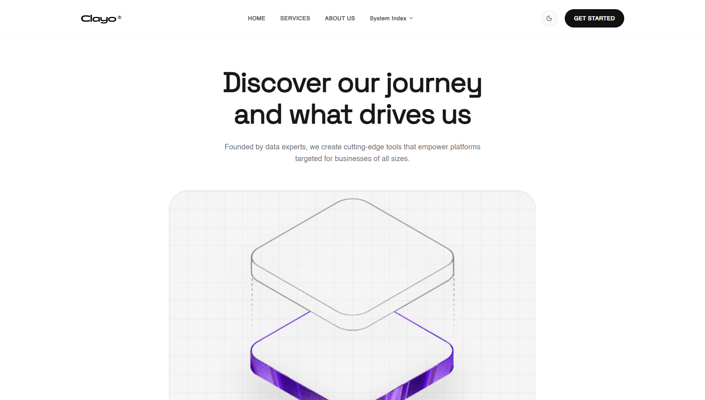

# Kyorva Analytics

A fintech marketing site for **Kyorva**, a real-time financial analytics
concept. Built with React 19, Vite, Tailwind CSS v4, and Framer Motion.

Live: [https://kyorva-finance.vercel.app](https://kyorva-finance.vercel.app)



## What this project is

This repository started as a clone of the
[`Footprintarts/tech-web`](https://github.com/Footprintarts/tech-web) starter.
The site's original design identity — the light-first white/zinc system, the
animated gradient wordmark footer, the SpaceGrotesk/Helvetica typography, the
black pill buttons, and the full section flow (Hero → Principles → About →
Features → How It Works → Use Cases → Approach → Insights → Get Started) —
is preserved. The public-facing brand was then evolved from the starter's
placeholder name to **Kyorva**, with a matching custom "strata" mark derived
from the hero artwork.

On top of that original design, this fork performs a defect-fix,
rebrand, and production-hygiene pass:

- **Distinctive brand** — "Kyorva": short, previously-unused name
  (kyorva.com confirmed unregistered via registry RDAP at selection time);
  applied consistently across wordmark, copy, metadata, favicon, OG image,
  and manifest.
- **Custom favicon system** — layered isometric "strata" mark in the brand
  gradient, with SVG master plus PNG renders (16/32, apple-touch, maskable
  192/512) generated by `node tools/make-icons.mjs`.
- **Broken fonts fixed** — the corrupted Google-Fonts `@import` never loaded;
  the site now relies solely on its own bundled TTFs (zero external requests).
- **Real content, no fabrications** — invented metrics, fake testimonials,
  and stock-photo "team members" were replaced with honest positioning copy;
  audience sections describe who the product is for, not invented customers.
- **Working controls** — "Get Started" leads to a validated email CTA
  (clearly labelled as a demo with no backend), "How it works" scrolls to
  the workflow section, the header dropdown and footer point at real
  sections.
- **Accessibility** — skip link, focus-visible outlines, labelled icon
  buttons, `aria-expanded` dropdown, Escape-to-close mobile dialog with
  scroll lock, reduced-motion support.
- **Theme persistence** — the dark-mode toggle survives reloads
  (`localStorage`, falling back to OS preference) with a pre-paint script
  that prevents a wrong-theme flash.
- **Performance & SEO** — real metadata, Open Graph/Twitter tags (PNG
  preview), canonical, theme-color, web manifest, `fetchpriority` hero
  image, and unused dependencies and dead code removed.
- **Asset generation** — `npm run gen` (see `tools/generate-assets.mjs`)
  produces style-locked images/video via the Higgsfield CLI with a free
  fallback, keeping new art on-brand.

## Run locally

```bash
npm install
npm run dev      # http://localhost:5173
npm run build    # production bundle in dist/
npm run lint
```

## Credits & license

- Original design, layout, and section components:
  [Footprintarts/tech-web](https://github.com/Footprintarts/tech-web)
  (ships without a license; credited here and in `LICENSE`).
- Base scaffold: [Vite](https://vite.dev) React template (MIT).
- Fixes, rebrand, and content work: Lakhyajit Changmai —
  [MIT License](LICENSE).
- Bundled fonts remain the property of their respective foundries as provided
  by the upstream starter.
