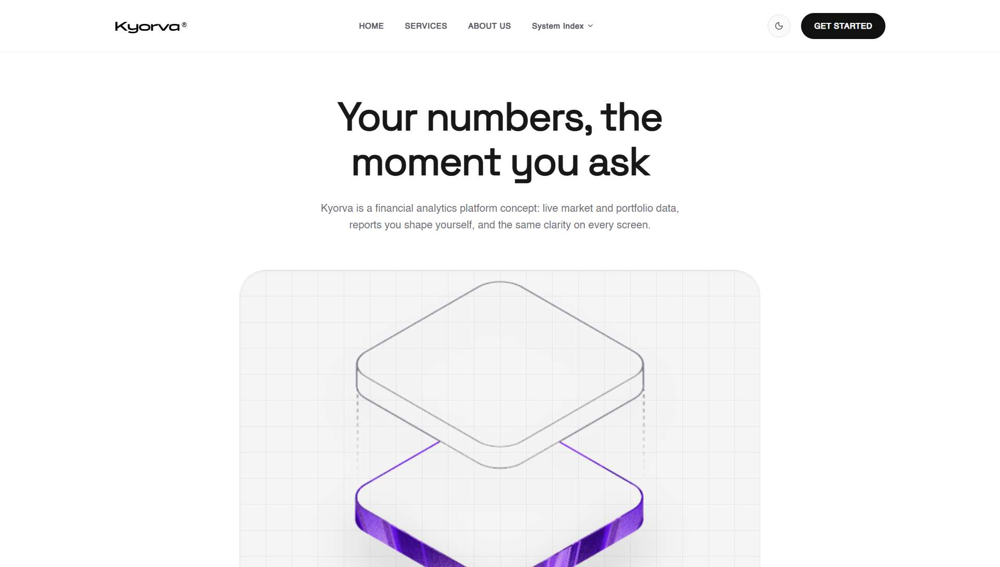

# Kyorva

**Real-time financial analytics, the moment you ask.**

A polished marketing site for Kyorva — a financial analytics *product
concept*. React 19 + Vite + Tailwind CSS v4 + Framer Motion, deployed on
Vercel, with a custom brand identity, zero external runtime requests, and
honest positioning copy throughout.

**Live demo: [kyorva.vercel.app](https://kyorva.vercel.app)**



---

## The problem & the audience

Financial data usually arrives late, locked in someone else's dashboard, and
unreadable on a phone. Kyorva's concept answers this with live market and
portfolio data, user-shaped reports, and one consistent experience across
screens. The site targets **independent investors**, **finance teams**, and
**small business owners** (see the *Who it's for* section).

## What is real vs. what is a concept

This is a **product-concept website**, not an operating SaaS. Being explicit
about it is part of the project:

| Implemented for real | Visual demonstration only |
| --- | --- |
| Full responsive site, dark/light theme with persistence and pre-paint flash fix | Live analytics data, accounts, reports |
| Keyboard-accessible nav, dropdown, mobile dialog, skip link, reduced motion | The hero/dashboard artwork |
| Validated waitlist form (clearly labelled as a demo; no data leaves the browser) | Customer names, logos, metrics — deliberately absent |
| Custom favicon/icon system, OG image, web manifest, canonical metadata | |

There are no invented customers, no fabricated metrics, and no fake
testimonials — the "Approach" section presents stated principles, not quotes
from imaginary users.

## Site tour

| Section | What it does |
| --- | --- |
| **Hero** | Proposition in one line + isometric "strata" product art |
| **Pillars** | Three positioning statements (Real-time / Tailored / Anywhere) |
| **Why Kyorva** | The problem framing; honest "pre-launch concept" disclosure |
| **Services** | Feature cards: real-time analytics, customizable reports, mobile |
| **How it works** | Three-step workflow: bring data → shape report → read anywhere |
| **Who it's for** | Audience cards (investors, finance teams, small businesses) |
| **Approach** | Product principles in an editorial layout |
| **Insights** | Article teasers with local CSS gradient art (no stock photos) |
| **Get started** | Email CTA with client-side validation, labelled as a demo |
| **Footer** | Animated gradient wordmark, section links, privacy statement |

## Design system

Light-first white/zinc surfaces, a single black pill as the primary action,
`PANCHANG` display type with `SpaceGrotesk`/Helvetica support, generous
`rounded-[2.5rem]` cards, and a violet→azure gradient (`#863bff → #47bfff`)
reserved for brand moments: the strata mark, section eyebrows, and the
animated footer wordmark. Dark mode (`#0B0B0B` surfaces) mirrors the same
hierarchy. The favicon, OG image, and hero art all derive from one SVG master,
so the identity stays coherent from a 16 px tab icon to a 1200 px social card.

## Tech stack

- **React 19** — UI (plain JSX; TypeScript types are lint/editor tooling only)
- **Vite 8** — dev server and build (Rolldown)
- **Tailwind CSS v4** — styling via `@tailwindcss/vite`
- **Framer Motion 12** — entrance animation, mobile dialog transitions
- **lucide-react** — iconography
- **Vercel** — hosting/CI
- **@resvg/resvg-js** (dev-only, not a site dependency) — icon rasterization

No router, no state library, no CSS-in-JS: the site is one static page with
anchor navigation, which keeps the bundle at ~110 kB gzipped JS.

## Architecture

Single-page marketing site rendered fully client-side:

- `src/App.jsx` owns the only app state (`darkMode`) and passes it down as
  props — no context, no store. Persistence lives in one effect that writes
  `localStorage` and syncs the `<html>` backdrop.
- `index.html` contains a ~10-line pre-paint script that resolves the theme
  (saved choice → OS preference) before React mounts, eliminating the
  wrong-theme flash.
- Components are one file per section under `src/components/`; content data
  lives in `src/assets/data.jsx`.
- All images/fonts are bundled locally (`src/assets`, `public/fonts`) — the
  production page makes **zero external network requests**.
- `tools/` holds the build-time generators: `make-icons.mjs` (SVG master →
  PNG icon set) and `generate-assets.mjs` (style-locked AI concept art).

## Directory structure

```
├── docs/               README screenshots
├── public/
│   ├── fonts/          Bundled brand fonts (TTF)
│   ├── icons/          Generated PNG icons + OG image
│   ├── favicon.svg     Strata mark (SVG master)
│   ├── og.svg          Social card source
│   └── manifest.webmanifest
├── src/
│   ├── assets/         Hero artwork + content data
│   ├── components/     Header, Hero, Metrics, AboutSection, Features,
│   │                   Workflow, UseCases, Testimonials, Articles,
│   │                   StartForm, Footer
│   ├── App.jsx         Theme state + section composition
│   ├── index.css       Tailwind v4 + fonts + brand tokens
│   └── main.jsx
├── tools/              Icon rasterizer, style-locked asset generator
├── index.html          Metadata, pre-paint theme script
└── vite.config.js
```

## Getting started

Prerequisites: **Node.js ≥ 20** and npm.

```bash
npm install
npm run dev        # http://localhost:5173
npm run lint       # ESLint (flat config)
npm run build      # production bundle → dist/
npm run preview    # serve the built bundle locally
```

Optional tooling (not needed for the site itself):

```bash
node tools/make-icons.mjs        # regenerate PNG icons from the SVG master
                                 # (requires: npm i --no-save @resvg/resvg-js)
npm run gen -- --image name ...  # style-locked concept art generation
                                 # (free Pollinations fallback; Higgsfield CLI
                                 #  used automatically when credits exist)
```

## Deployment (Vercel)

The project is a plain Vite app — zero configuration required:

```bash
vercel link                     # link to your Vercel project
vercel deploy --prod            # ship it
```

Framework preset **Vite** is auto-detected; build command `npm run build`,
output directory `dist`.

## Environment variables

**None required.** The site has no backend and reads no `import.meta.env`
variables. (`VERCEL_OIDC_TOKEN` may appear in `.env.local` after
`vercel link`; it is Vercel-managed, development-scoped, gitignored, and
unused by this project.)

## Accessibility, responsiveness & performance

- Skip link, visible focus rings, labelled icon buttons, `aria-expanded`
  dropdown, Escape-to-close mobile dialog with body scroll lock.
- Honors `prefers-reduced-motion` and the saved theme choice; theme never
  flashes on load.
- Fluid layouts from 360 px to ultrawide; no horizontal scroll.
- Static export: ~110 kB gzipped JS, ~8 kB gzipped CSS, one hero image with
  `fetchpriority="high"`, no third-party scripts, fonts, or requests.

## Known limitations

- The waitlist form is front-end only — there is **no backend**; submissions
  are validated and acknowledged in-page, and nothing is stored or sent.
- Product sections describe a concept, not shipped functionality.
- No automated test suite (lint + production build are the CI gates).

## License & attribution

MIT © Lakhyajit Changmai — see [LICENSE](LICENSE).

This repository began as a clone of the
[Footprintarts/tech-web](https://github.com/Footprintarts/tech-web) starter;
its original design identity (layout, section system, typography, animated
footer) is preserved and was fixed, rebranded, and productionized here. The
base scaffold is the Vite React template (MIT). Bundled fonts remain the
property of their respective foundries as provided by the upstream starter.

## Links

- Live site: <https://kyorva.vercel.app>
- Repository: <https://github.com/lakhyach/Kyorva>
- Original design snapshot tag: [`clayo-snapshot`](https://github.com/lakhyach/Kyorva/tree/clayo-snapshot)
